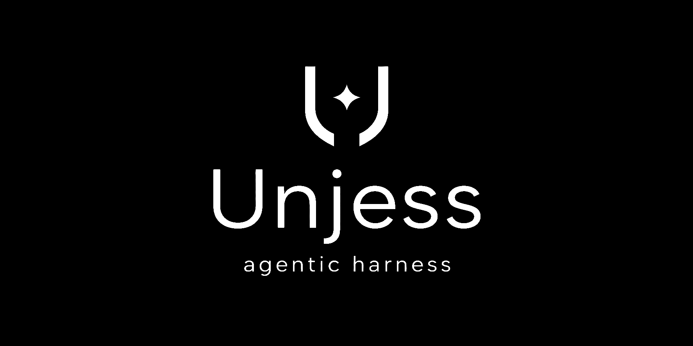
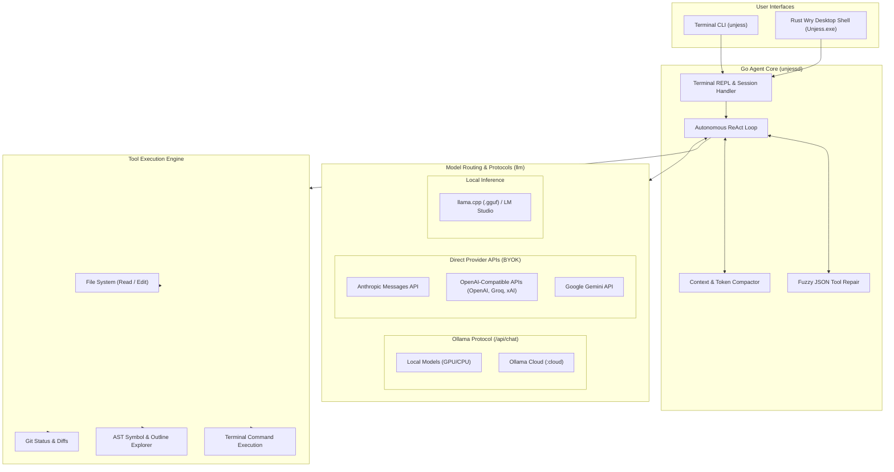
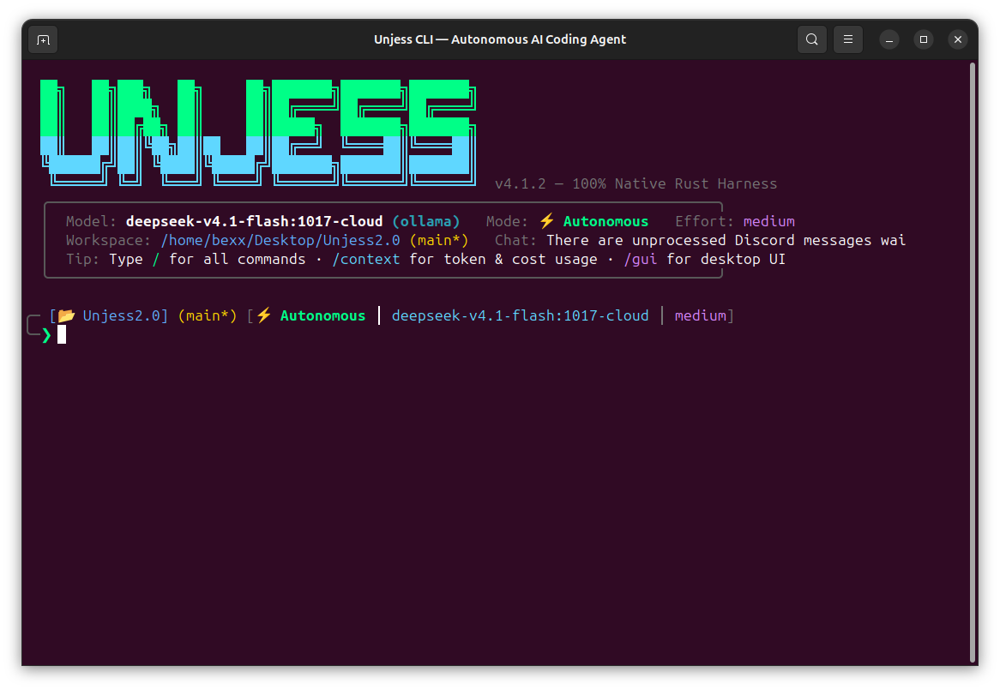
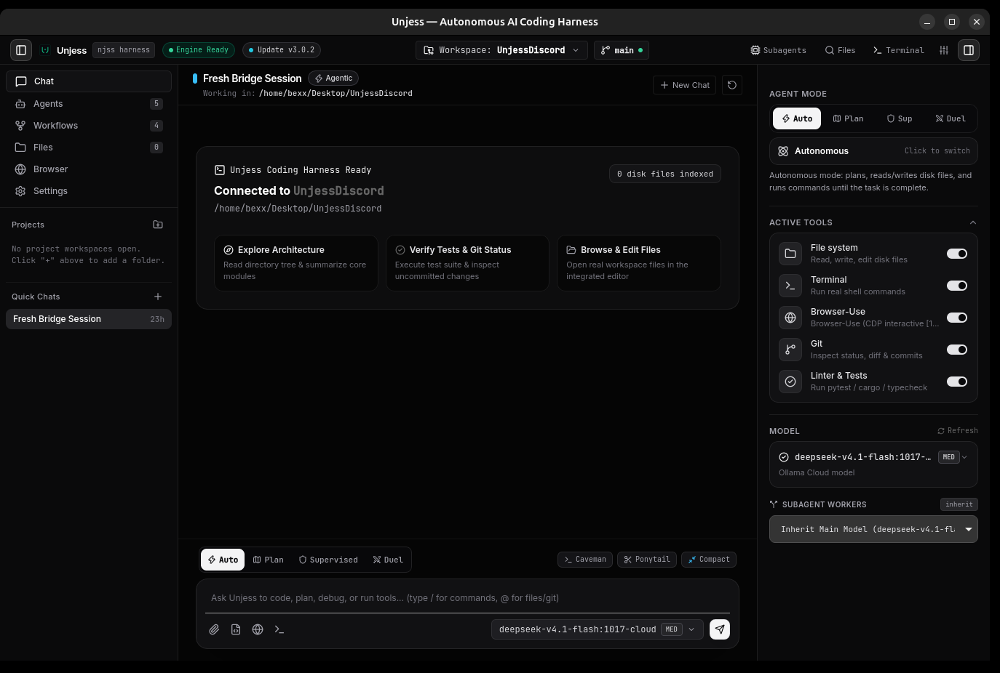

# Unjess — Go Agent Daemon + Rust Wry Desktop Wrapper



> **Status:** Open-source prototype project built by a solo developer exploring autonomous coding agent runtimes with AI pair-programming. Shared under the MIT license.

**Unjess** is a lightweight AI coding assistant prototype composed of a compiled **Go backend daemon (`unjessd`)**, an interactive terminal CLI (`unjess`), and a minimal **Rust Wry (WebView2) desktop wrapper (`Unjess.exe`)**.

---

## Why Unjess?

- **Lightweight Runtime Footprint:** Built in compiled Go and Rust Wry — no Electron runtime, no heavy Python virtual environments, minimal idle RAM consumption.
- **Protocol & Provider Freedom:** Connect local offline models or remote models via **Ollama / Ollama Cloud**, or use your own API keys directly with **Anthropic Messages API**, **OpenAI-compatible endpoints** (OpenAI, Groq, Mistral, xAI, OpenRouter), and **Google Gemini API**.
- **No Subscription Lock-In:** No proprietary proxy server, no paid platform subscriptions. Uses direct API keys or local hardware.
- **Terminal-First with Optional GUI:** Run directly inside your terminal REPL (`unjess`) or launch the lightweight desktop window.
- **Fuzzy Tool-Call Recovery:** Heuristic recovery for minor LLM JSON formatting errors and parameter aliasing to prevent agent loop crashes.

---

## Architecture



### Directory Structure

```
unjess/
├── daemon/                         # Go Backend Server & CLI (Go 1.26+)
│   ├── cmd/
│   │   ├── unjessd/                # Local HTTP + SSE Daemon Server (127.0.0.1:8765)
│   │   ├── unjess-cli/             # Terminal REPL & Command CLI (unjess)
│   │   ├── installer/              # Windows Setup Wizard (Unjess-Setup.exe)
│   │   └── uninstaller/            # Windows Uninstaller (Unjess-Uninstall.exe)
│   └── internal/
│       ├── agent/                  # Autonomous ReAct Loop & Context Compactor
│       ├── api/                    # REST + SSE Streaming API & Embedded Web UI
│       ├── cli/                    # Terminal REPL & Diff Viewer
│       ├── codeintel/              # AST Symbol & Caller Exploration
│       ├── config/                 # Settings & Multi-Provider Registry
│       ├── llm/                    # Streaming LLM Adapters (Ollama, Anthropic, OpenAI, Gemini)
│       ├── mcp/                    # Model Context Protocol (MCP) Client
│       ├── memory/                 # Persistent Workspace Memory Store
│       ├── skills/                 # Custom Skill Runner (SKILL.md)
│       ├── tools/                  # Workspace Tools (read, edit, bash, search)
│       └── updater/                # In-App SHA-256 Release Updater
├── crates/                         # Rust Workspace
│   ├── unjess-desktop/             # Rust Wry/Tao (WebView2) Desktop Wrapper (Unjess.exe)
│   └── unjess-core/                # Rust Shared Workspace Primitives
├── src/unjess/
│   └── desktop/index.html          # Embedded Monochrome UI
├── build-all.ps1                   # Unified Cross-Compilation Build Script
└── version.json                    # Release Metadata & Changelog
```

---

## Top 5 Decisions & Tradeoffs (Brutal Honesty)

1. **Ship fast with AI pair-programming vs Upfront Modularization:**
   *Decision:* Prioritized getting a working end-to-end agent loop capable of reading, editing files, and running commands quickly rather than spending weeks over-engineering abstractions.
   *Honest Trade-off:* The codebase contains large monolithic files (`agent.go`, `tools.go`) that work reliably but require refactoring into smaller domain packages.

2. **Lightweight Compiled Binaries vs Heavy Electron/Node Ecosystem:**
   *Decision:* Built the backend daemon in compiled Go and the desktop shell in a minimal Rust Wry wrapper (~10 MB combined footprint, instant startup, minimal RAM).
   *Honest Trade-off:* The desktop UI is a minimal webview shell rather than a heavily customized IDE platform like VS Code.

3. **Multi-Protocol Routing: Ollama (Local + Cloud) & Direct Provider REST APIs:**
   *Decision:* Rather than forcing users into a proprietary cloud subscription or single vendor, Unjess routes directly to Ollama (`/api/chat` for local GPU models and Ollama Cloud remote models) and native provider APIs (Anthropic Messages, OpenAI-compatible, Google Gemini).
   *Honest Trade-off:* Each provider uses different streaming semantics, tool schemas, and error structures, requiring separate adapter maintenance in `llm/`.

4. **Tolerant Fuzzy Tool Repair vs Strict JSON Validation:**
   *Decision:* LLMs frequently make minor syntax errors in tool call JSON (missing trailing brackets, unescaped characters). Unjess incorporates heuristic auto-repair and parameter aliasing so minor formatting glitches don't terminate the task loop.
   *Honest Trade-off:* Heuristics can occasionally guess arguments incorrectly instead of forcing rigid schema validation.

5. **Terminal-First Workflow with an Optional Desktop Shell:**
   *Decision:* Designed primarily for developers working directly in terminal sessions and tmux who want fast keyboard-driven interaction, while providing a desktop window wrapper for visual status.
   *Honest Trade-off:* It is not a beginner-oriented point-and-click tool; it is a hacker's pair-programmer.

---

## User Experience

### Interactive Terminal CLI
The terminal interface provides an autonomous loop with live token telemetry, model reasoning streams, and tool execution status:



### Rust Wry Desktop Wrapper
A lightweight desktop wrapper window (~1.3 MB) featuring obsidian noir styling, quick workspace actions, model provider switching, and real-time tool inspection:



---

## Getting Started

### Pre-built Binaries (Windows & Linux)
Download the latest pre-compiled binaries and installers from [GitHub Releases](https://github.com/Bexx1107/Unjess-Go/releases/latest).

- **Windows:** Run `Unjess-Setup.exe` (or launch `Unjess.exe` directly).
- **Linux:** Run `./unjessd-linux-amd64` to start the daemon, and `./unjess-linux-amd64` for the CLI.

---

## Building from Source

### Prerequisites
- **Go 1.26+**
- **Rust (stable toolchain via `rustup`)**
- **Windows 10/11** (WebView2 Runtime installed) or **Linux (`amd64` / `arm64`)**

### Windows (Full Pipeline)
Run the PowerShell build script from the repository root:
```powershell
.\build-all.ps1
```

To build only the Go components:
```powershell
.\build-all.ps1 -SkipRust
```

### Manual Compilation

**Go Daemon & CLI (`daemon/`):**
```bash
cd daemon
go test ./internal/...
go build -trimpath -ldflags="-s -w" -o ../bin/unjessd ./cmd/unjessd
go build -trimpath -ldflags="-s -w" -o ../bin/unjess ./cmd/unjess-cli
```

**Rust Desktop Shell (`crates/unjess-desktop`):**
```bash
cd crates/unjess-desktop
cargo build --release
```

---

## Usage

### Desktop Application
Launch `Unjess.exe`. It automatically connects to the local `unjessd` background daemon on `127.0.0.1:8765` and opens the desktop wrapper window.

### Terminal CLI (`unjess`)
```bash
# Interactive REPL in your current workspace
unjess

# Single-shot task execution
unjess "Refactor the authentication middleware and run tests"

# Specify prompt directly
unjess --prompt "Analyze the git status"
```

### Common Commands
- `/plan` — Toggle read-only planning mode
- `/compact` — Trigger context compaction
- `/context` — Inspect token usage and context breakdown
- `/mcp` — Inspect connected Model Context Protocol servers
- `/help` — View available commands

---

## Roadmap & Known Limitations

- **Early Development:** This project is actively being developed and refined. Breaking changes may occur between minor versions.
- **UI in Progress:** The desktop wrapper interface is continually being iterated on.
- **Community:** Feedback, bug reports, and contributions are welcome via GitHub Issues.

---

## License

Distributed under the [MIT License](LICENSE).
